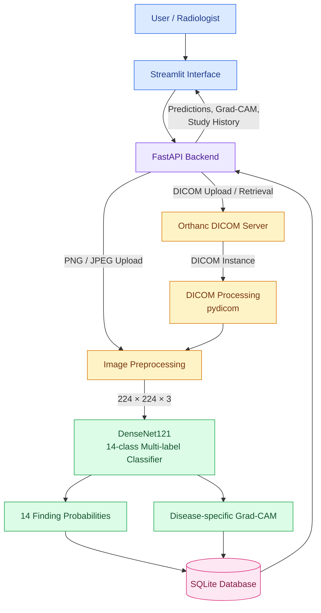
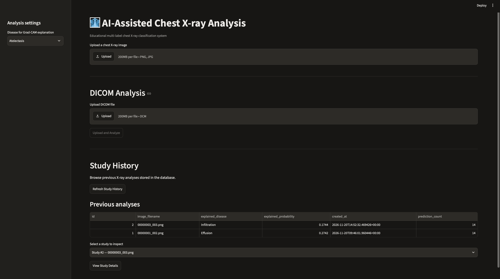
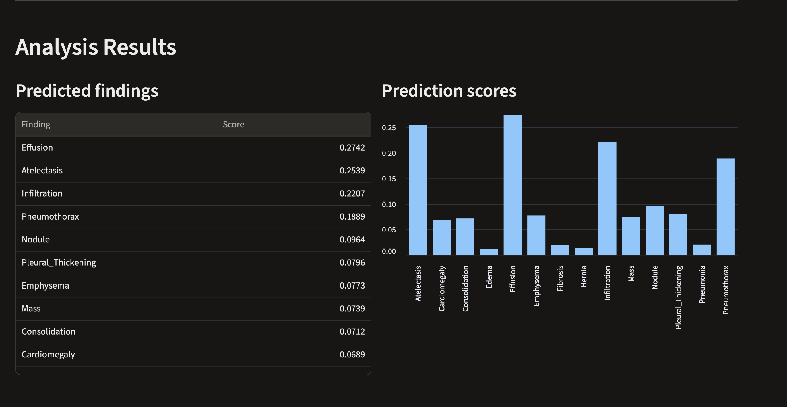
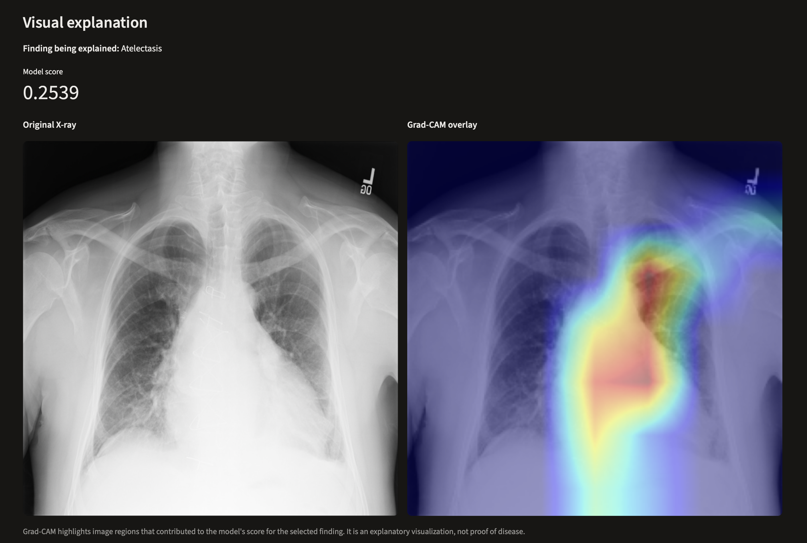
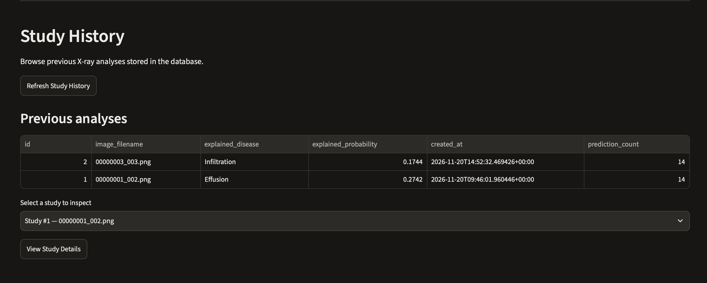
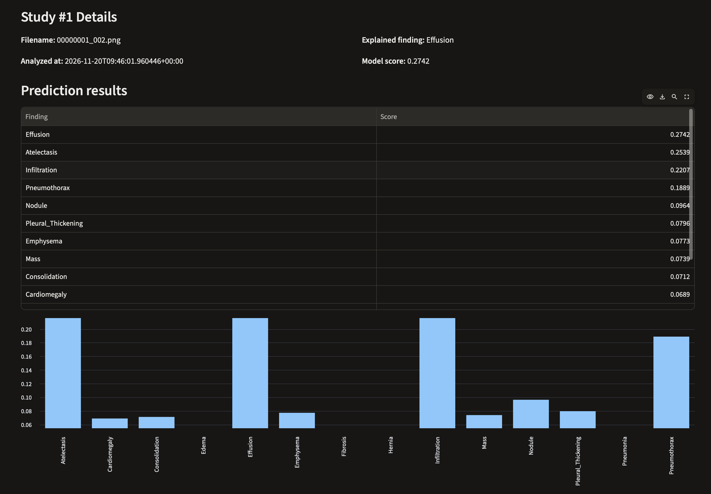
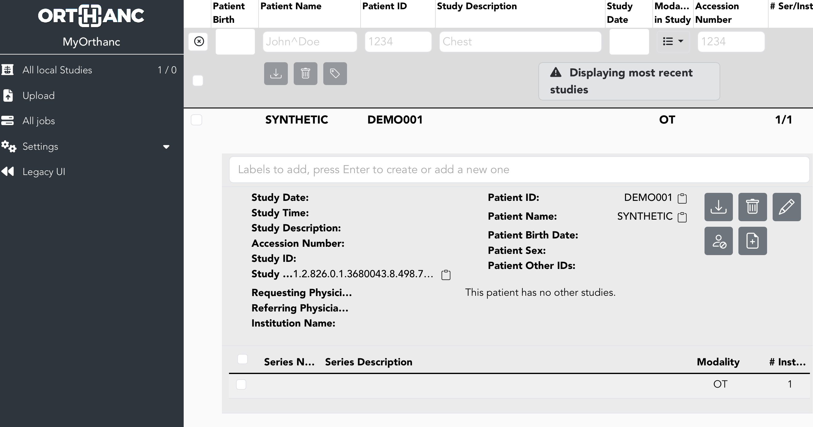
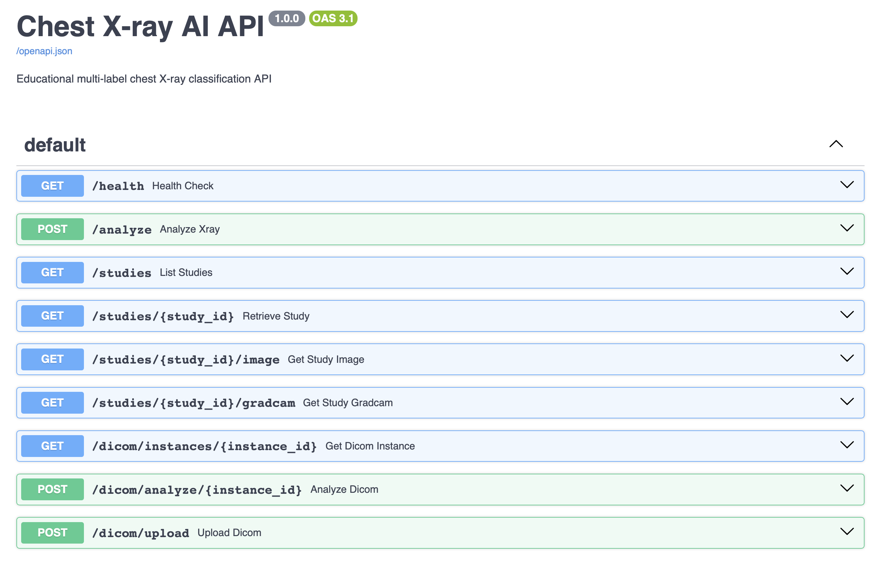
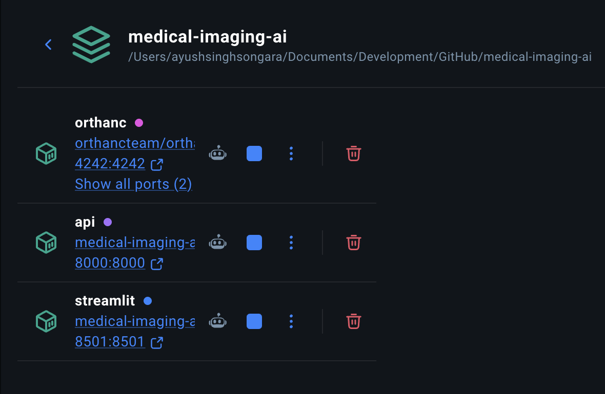

# AI-Assisted Medical Imaging System

An educational chest X-ray classification system that uses deep learning to identify 14 thoracic findings from chest X-ray images.

> **Disclaimer:** This project is intended for educational and research purposes only. It is not a clinically validated diagnostic system and must not be used for medical decision-making.

## 1. Project Overview

The system provides:

- Chest X-ray image analysis using DenseNet121.
- Multi-label classification of 14 thoracic findings.
- Disease-specific Grad-CAM visualizations.
- DICOM image ingestion and retrieval using Orthanc.
- Prediction API using FastAPI.
- Interactive interface using Streamlit.
- Study history and prediction storage using SQLite.

## 2. Technology Stack

| Component | Technology |
|---|---|
| Deep Learning | TensorFlow / Keras |
| Model Architecture | DenseNet121 |
| Dataset | NIH ChestX-ray14 |
| Explainability | Grad-CAM |
| Backend | FastAPI |
| Frontend | Streamlit |
| DICOM Server | Orthanc |
| DICOM Processing | pydicom |
| Database | SQLite |
| Data Versioning | DVC |
| Containerization | Docker Compose |
| Testing | Pytest |

DVC metadata is included in the repository. A remote DVC storage location is not currently configured.

## 3. Model

The project uses ImageNet-pretrained DenseNet121 with a custom classification head.

The model predicts 14 thoracic findings:

1. Atelectasis
2. Cardiomegaly
3. Effusion
4. Infiltration
5. Mass
6. Nodule
7. Pneumonia
8. Pneumothorax
9. Consolidation
10. Edema
11. Emphysema
12. Fibrosis
13. Pleural_Thickening
14. Hernia

The output layer uses sigmoid activation because this is a multi-label classification problem. An individual X-ray can contain more than one finding.

## 4. System Architecture




## 5. Dataset and Preprocessing

This project uses the NIH ChestX-ray14 dataset, containing 112,120 frontal-view chest X-ray images with 14 thoracic finding labels.

The task is formulated as multi-label classification because an individual X-ray may contain multiple findings.

### Dataset Splitting

The dataset was divided into patient-wise training, validation, and test sets.

| Split | Images |
|---|---:|
| Training | 78,566 |
| Validation | 16,106 |
| Test | 17,448 |
| **Total** | **112,120** |

The model was trained using the complete downloaded dataset.

For application deployment and inference testing, approximately 500 images were retained locally. The application also supports user-uploaded PNG and JPEG images.

Patient-wise splitting was used to reduce patient-level data leakage between the training, validation, and test sets.

### Preprocessing

The preprocessing pipeline includes:

- Image decoding and resizing.
- Grayscale-to-RGB conversion.
- DenseNet121 ImageNet preprocessing.
- Multi-hot encoding of disease labels.

## 6. Model Training

The model uses ImageNet-pretrained DenseNet121 as its feature extractor, followed by a custom classification head consisting of Global Average Pooling, Dropout, and a 14-unit sigmoid output layer.

| Parameter | Configuration |
|---|---|
| Input size | 224 × 224 × 3 |
| Optimizer | Adam |
| Initial learning rate | 0.001 |
| Loss function | Binary Cross-Entropy |
| Output layer | 14 sigmoid units |
| Training duration | 5 epochs |
| Framework | TensorFlow / Keras |

The five-epoch training run showed improving validation ROC-AUC and PR-AUC across the training epochs.

Training histories are available in the `models/` directory.

## 7. Model Evaluation

The model was evaluated on the held-out test dataset using multi-label classification metrics.

### Overall Test Performance

| Metric | Macro Score |
|---|---:|
| ROC-AUC | 0.731 |
| PR-AUC | 0.118 |
| Precision | 0.124 |
| Recall | 0.292 |
| F1-score | 0.171 |

Class-specific classification thresholds were selected by maximizing F1-score on the validation dataset and subsequently applied to the test dataset.

The strongest F1-scores were observed for:

| Finding | F1-score |
|---|---:|
| Infiltration | 0.369 |
| Effusion | 0.356 |
| Pneumothorax | 0.279 |
| Atelectasis | 0.276 |

The results indicate that the model learned some discriminative patterns but continues to exhibit low precision and substantial false-positive predictions. Performance also varies considerably across disease categories, particularly for underrepresented findings.

**Important evaluation notes:**

- ROC-AUC and PR-AUC measure ranking performance and do not depend on the selected classification thresholds.
- Precision, recall, and F1-score are reported using the class-specific thresholds selected on the validation dataset.
- These thresholds are experimental and have not been clinically established.
- Some findings have limited test samples, which makes their individual performance estimates less reliable.

Evaluation artifacts are available under:

```text
data/processed/evaluation/
```

## 8. Model Artifact

The final inference model is available at:

```text
models/best_model.keras
```

Training histories are available under:

```text
models/
```

The evaluation artifacts include per-class metrics and the selected classification thresholds.

## 9. Application Screenshots

### Streamlit Interface



### Image Analysis Results



### Grad-CAM Visualization



### Study History



### Study Details



### Orthanc DICOM Server



### FastAPI Documentation



### Docker Deployment



## 10. Run with Docker Compose

### Prerequisites

- Docker Desktop
- Docker Compose

### Environment Configuration

Create a `.env` file in the project root:

```env
ORTHANC_PASSWORD=your-dev-password
```

Do not commit the `.env` file or production credentials to version control.

### Start the Application

```bash
docker compose up --build -d
```

### Access the Services

| Service | URL |
|---|---|
| Streamlit | http://localhost:8501 |
| FastAPI | http://localhost:8000/docs |
| Orthanc | http://localhost:8042 |

### Stop the Application

```bash
docker compose down
```

## 11. Testing

The project includes tests for DICOM processing, database operations, and API endpoints.

Run the complete test suite:

```bash
PYTHONPATH=src uv run pytest tests/ -v
```

## 12. Limitations

- The model is trained on the NIH ChestX-ray14 dataset and may not generalize to other datasets or imaging environments.
- Model outputs are not calibrated clinical probabilities.
- Dataset labels may contain uncertainty and noise.
- Class imbalance affects model performance, particularly for less frequently represented findings.
- The system has not undergone clinical validation.
- DICOM preprocessing currently supports the synthetic 8-bit grayscale Secondary Capture demonstration. General clinical DICOM handling requires additional implementation and validation.

## 13. Future Improvements

- More comprehensive model evaluation.
- Improved DICOM preprocessing and modality support.
- Additional integration and system tests.
- Model performance and bias analysis.
- Improved study review and visualization interface.
- More robust deployment and monitoring.

## 14. Disclaimer

This project is an educational and research prototype. It is not intended to replace radiologists or other qualified healthcare professionals. Its predictions must not be used for medical diagnosis or treatment decisions.